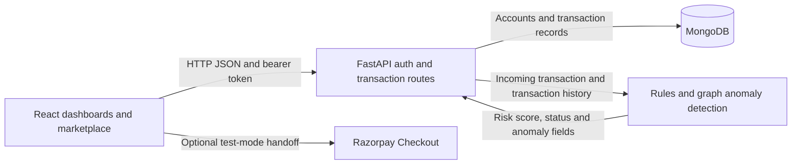
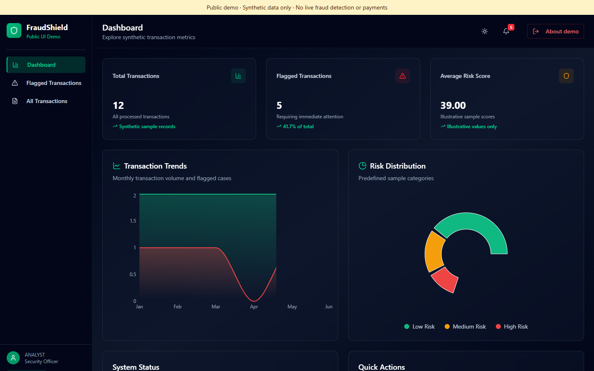
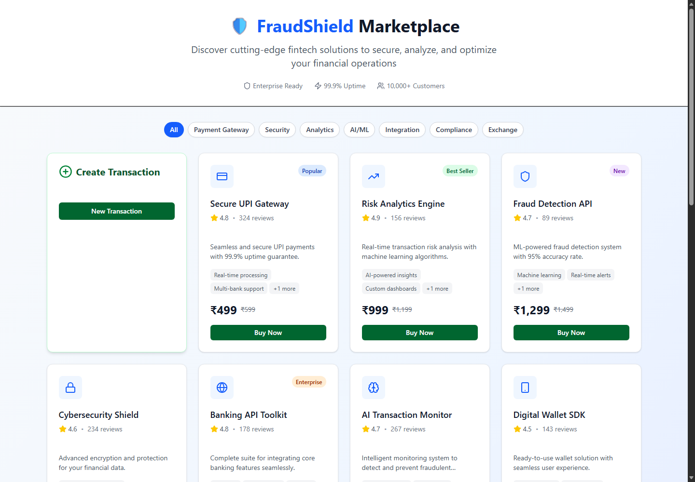
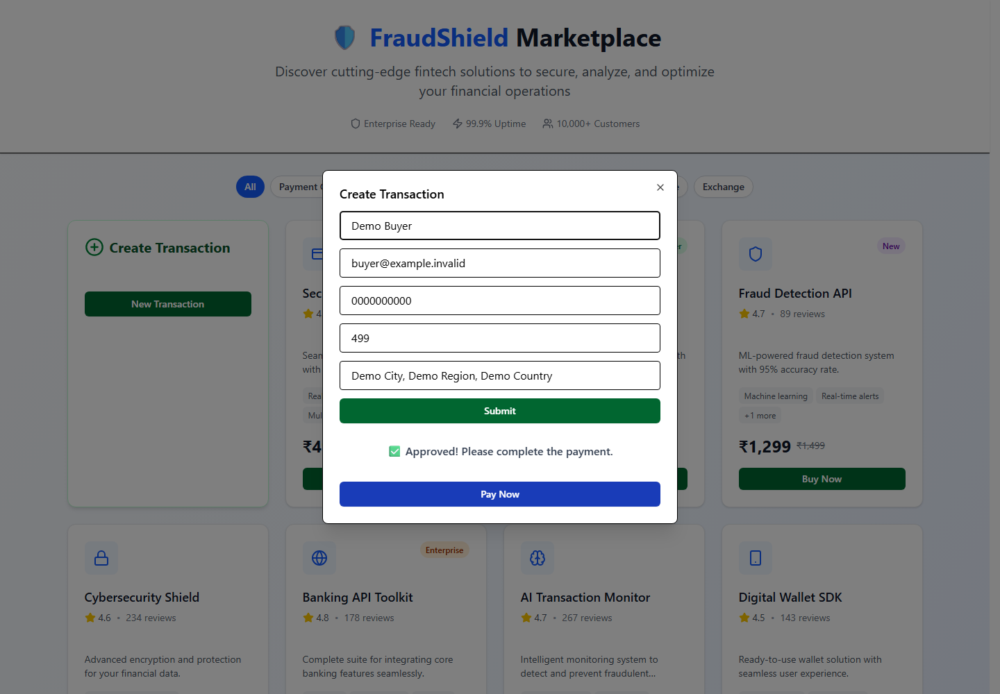
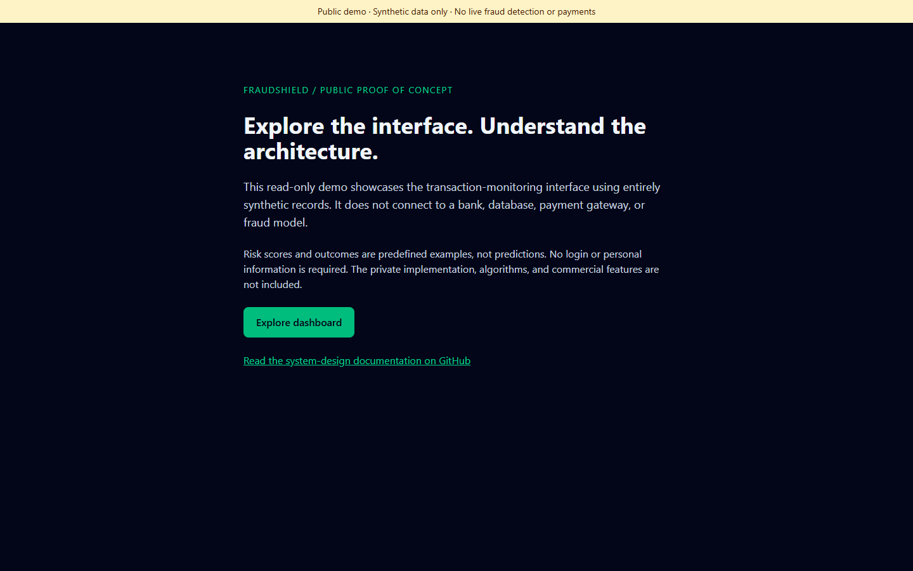

# Fraudshield - Intelligent Banking Platform

## Abstract

FraudShield is a final-year master's engineering project that integrates transaction risk assessment with operational review. A React frontend calls a FastAPI backend that evaluates synthetic transactions, persists decisions in MongoDB, and exposes review queues and analytics. The prototype combines explainable fraud rules with a graph-based anomaly signal and includes a fixture-backed marketplace with an optional Razorpay test-mode handoff.

## Problem and objectives

Transaction monitoring must surface records that warrant review and provide enough context for an analyst to understand the decision. A rule can explain why a single record was flagged. Relationships among senders, devices, and IP addresses provide a second view of unusual behavior across records.

The project implements three engineering contributions:

- A transaction pipeline that records rule scores, workflow status, and graph anomaly results alongside the transaction.
- An analyst workflow linking risk assessment to dashboards, flagged review, status decisions, and transaction exports.
- A reproducible local prototype for exercising the API, analytics pipeline, and marketplace with synthetic fixtures.

## Core capabilities

| Capability | Implemented behavior |
| --- | --- |
| Transaction risk assessment | Evaluates transaction amount, location, and IP heuristics. Runs graph-based anomaly detection and records its result separately from the rules-based status. |
| Review and monitoring | Provides transaction history, a flagged queue, monthly and risk-distribution charts, summary counts, and CSV export. Authorized users can update review status. |
| Accounts and access control | Public registration creates an analyst account. Passwords are hashed with bcrypt and login issues an expiring HS256 JWT. Protected API routes enforce role checks. |
| Marketplace | Displays synthetic product listings, a manual transaction form, and optional Razorpay Checkout entry points. The product catalog and its statistics are demonstration content. |
| Optional components | Provides a separate advisory Random Forest endpoint and receipt OCR when explicitly configured. See [optional components](docs/OPTIONAL_COMPONENTS.md) and [ML experiments](ML/README.md). |

## Technology and architecture

| Layer | Tools |
| --- | --- |
| Web | React, React Router, Vite, Tailwind CSS, shadcn/ui and Radix UI, Lucide, Recharts |
| API and persistence | FastAPI, Pydantic, Uvicorn, PyMongo, MongoDB |
| Fraud evaluation | Python, pandas, NetworkX, Node2Vec, scikit-learn Isolation Forest, and deterministic rules |
| Authentication | PyJWT, HS256 bearer tokens, Passlib and bcrypt |
| Payment handoff | Razorpay Checkout browser SDK with a test-key format guard |
| Verification | Python unittest, Node.js test runner, Vite production build, GitHub Actions |



### Fraud detection methodology

- **Operational rules.** The scorer assigns 50 points for an amount above 10,000, 25 for a location outside the configured list, and 15 for an IP string that does not start with `192.`. A score of 50 or higher produces the initial flagged status. These are prototype heuristics. Browser-supplied location and IP fields require stronger validation in a shared deployment.
- **Graph anomaly signal.** The backend uses the proposed transaction and transaction history to connect senders to devices, IP addresses, and product nodes when present. Node2Vec generates node embeddings, and Isolation Forest identifies unusual nodes. The backend records whether the sender was identified as anomalous in separate ML fields. The rules engine determines the initial operational status.
- **Standalone experiments.** The [ML workspace](ML/README.md) compares Isolation Forest and DBSCAN over synthetic transaction graphs. The optional Random Forest endpoint is advisory. The repository does not report real-world model performance.

### Transaction lifecycle

1. An authorized analyst or administrator submits a transaction. FastAPI validates the request against the transaction schema and enforces the API role requirement.
2. The backend builds a graph from transaction history and the proposed record, creates Node2Vec embeddings, and evaluates anomalies with Isolation Forest. It records the anomaly result in separate ML fields.
3. The rules engine computes the operational risk score and returns an approved or flagged status. MongoDB stores the input, score, status, and anomaly fields. The API returns the stored record to the UI.
4. The flagged queue supports review. The transaction status route supports approved, blocked, and false-positive decisions. A separate manual approval endpoint requires an administrator.
5. The manual marketplace form exposes **Pay Now** after an approved response. The product checkout entry point is separate and does not enforce the same pre-payment review. Checkout is disabled by default.

### Engineering trade-offs

- MongoDB stores risk output alongside each transaction, allowing the API to return review context with the record. Transaction history feeds an in-process cache and graph evaluation in the create path, coupling scoring work to request latency. No throughput or scale measurements are claimed.
- Rules produce readable risk reasons and an operational classification. The graph detector provides a separate anomaly signal. The bundled fixtures are synthetic and support functional checks without establishing real-world accuracy.
- The browser calls grouped API routes for accounts, transactions, and optional components. FastAPI returns HTTP errors for invalid inputs and denied operations, and the frontend API helper preserves error details for the UI. API role checks are the enforcement boundary.
- Checkout demonstrates an SDK handoff. This tree does not implement server-side order binding, signature verification, idempotent payment callbacks, or settlement reconciliation. Keep checkout disabled for the portfolio walkthrough.

## Run locally

Use Python 3.12 and Node.js 22 with npm, a running local MongoDB instance, and disposable data. Python 3.11 or newer is required for MongoDB SRV connections. The commands below use PowerShell.

```powershell
git clone https://github.com/cobraroot404-a11y/fraudshield.git
cd fraudshield
cd backend
python -m venv .venv
.\.venv\Scripts\python -m pip install -r requirements_updated.txt
Copy-Item .env.example .env
# Edit .env before starting the backend.
.\.venv\Scripts\python -m uvicorn main:app --host 127.0.0.1 --port 8000
```

In [backend/.env.example](backend/.env.example), the default MongoDB URI points to port 27017 on localhost. Use a fresh URL-safe HS256 signing secret of at least 43 characters. Generate one locally with `python -c "import secrets; print(secrets.token_urlsafe(32))"`. Keep the generated value in the local backend environment file. The example sets the bearer token lifetime to 30 minutes.

In a second terminal, from the repository root:

```powershell
cd frontend
npm ci
npm run dev -- --host 127.0.0.1 --port 5173 --strictPort
```

Open `http://localhost:5173/login`. FastAPI's interactive reference is at `http://127.0.0.1:8000/docs`. The API permits the local frontend origin on port 5173.

### Synthetic walkthrough

1. Register a disposable analyst account, then sign in. Open the analyst dashboard, transaction list, and flagged queue. Open the general dashboard at `http://localhost:5173/` for the summary and charts.
2. Open **Go to Marketplace** from the sign-in screen or visit `http://localhost:5173/marketplace` in the same browser session. Use **New Transaction** with fictional buyer details. The form may look up IP and location through external services, so use only a disposable local environment and synthetic data.
3. Submit a synthetic transaction and inspect the actual response and dashboard. The source rules flag amounts above 10,000 on amount alone. Smaller amounts may still be evaluated against the other rules. A blocked status is a review decision, and admin-only screens require a locally provisioned administrator.
4. Browse the synthetic catalog or stop at **Pay Now** when the manual flow is approved. The [frontend environment example](frontend/.env.example) leaves `VITE_RAZORPAY_KEY_ID` empty. The optional SDK path accepts a test-mode key ID when configured, but the documented portfolio walkthrough leaves checkout disabled.

## UI screenshots

The dashboard, alerts, transaction, and About images are original captures of the historical demo. All six images show synthetic demonstration content.

### Dashboard Overview



### Fraud Alerts


### Transaction Overview


### Marketplace Demo

**FraudShield Marketplace Demo — Synthetic Product Catalog**



### Simulated Razorpay Pre-checkout

**FraudShield simulated pre-checkout. No hosted checkout opened and no payment was completed.**



### About FraudShield



See the [capture provenance, hashes, and notices](docs/FraudShield-demo-screenshots.md).

## Testing and validation

Run the backend suite from `backend/` with the pinned environment and the frontend suite from `frontend/`.

```powershell
# backend/
.\.venv\Scripts\python -m unittest discover -s tests -v

# frontend/
npm test
npm run build
```

The release candidate's local Windows validation recorded 16 backend tests and 4 frontend tests passing. The backend suite covers JWT validation, manual review persistence with a mocked collection, the optional Random Forest scorer, and receipt parsing and worker handling. The frontend suite covers API request and response behavior and the test-only checkout key guard. Four offline browser checks exercised synthetic approved, flagged, and blocked manual outcomes and the disabled product checkout guard. The production build succeeded with a bundle-size warning. These checks measure functional behavior with fixtures. A fresh Python advisory lookup and independent hosted Razorpay validation were unavailable in the release-review environment.

## Authentication and security

Login verifies the stored bcrypt password hash and issues an expiring HS256 bearer token. The API validates the token's signature, expiry, subject, and role. Protected transaction routes apply role checks, and user administration requires an administrator. The local environment file supplies the signing secret and MongoDB connection settings.

## Limitations and future work

Keep the application bound to localhost and use synthetic data. Public registration grants analyst access to a shared local transaction dataset. A shared deployment would require controlled enrollment, per-user or tenant data boundaries, and review of browser-supplied risk inputs. Payment activation would require server-side order binding, signature verification, idempotent callbacks, and reconciliation. Model evaluation on representative labeled data and performance testing under load remain outside the recorded fixture checks. See [security guidance](SECURITY.md).

## Ownership and licensing

Copyright (c) 2026 Gautham. All rights reserved.

FraudShield is source-visible and proprietary under the [Proprietary Source-Visible License](LICENSE). Third-party components keep their own terms. See the [project notices](THIRD_PARTY_NOTICES.md) and [screenshot notices](docs/FraudShield-screenshot-icon-notice.txt).
