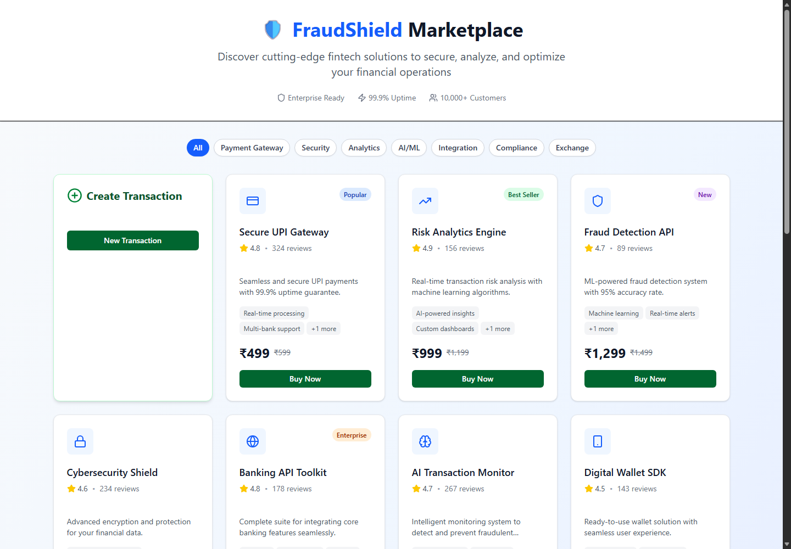
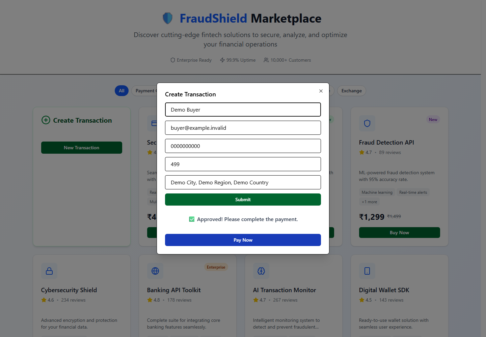

# FraudShield demo screenshots

The Marketplace and pre-checkout images were captured November 21, 2026 in Microsoft Edge 158.0.4370.33 on Windows at 1440 × 1000. The Marketplace capture used the existing `review/local-project` candidate frontend, staged tree `26327e701430dbf3d3d0c7a6e1a9741d079235e2`, with the checkout key empty.

## FraudShield Marketplace Demo — Synthetic Product Catalog

Opened **Go to Marketplace** from `/login`. The `/marketplace` route renders the product fixtures in `frontend/src/pages/Marketplace.jsx`. Product claims, prices, ratings, review counts, and customer metrics are demo copy. **All** showed 12 product cards and **Analytics** showed two. The screenshot shows the top of the **All** view.

## Simulated pre-checkout

**FraudShield simulated pre-checkout. No hosted checkout opened and no payment was completed.**

The **New Transaction** dialog shows a synthetic ₹499 transaction and the app’s **Pay Now** button. A browser fixture supplied a reserved documentation IP, a fictional location, and the transaction API’s `approved` response. The browser verified that the dialog renders the fixture approval exactly once. The browser intercepted the API request, so the backend and database were outside this test. The screenshot shows FraudShield’s own screen before the Razorpay handoff.

The pre-checkout image was recaptured from the production frontend build of the staged candidate plus the local display-only deletion of the duplicate status block in `frontend/src/pages/Marketplace.jsx`. An offline browser harness opened `/marketplace`, supplied the transaction and geolocation fixtures, and blocked outbound requests. The capture stopped at **Pay Now**. No Razorpay credentials were configured, no hosted checkout opened, and no payment was initiated or completed.

## Provenance and third-party notices

- The product UI and catalog come from the candidate’s local source. The new captures were made from that running build. Gautham confirmed ownership of the original first-party screenshot content in the four historical captures. The prior provenance review traced them to the same synthetic demo and identified visible Lucide and Feather icons and Recharts output. The four historical images were restored directly from their original Git blobs, preserving their exact bytes, dimensions, and appearance.
- The visible SVG icons come from `lucide-react` 0.511.0. The accompanying notice includes the complete bundled Lucide ISC and Feather MIT terms. Visible Feather-derived icons include the plus-circle, lock, smartphone, and dialog close icon. Keep the accompanying [icon notice](FraudShield-screenshot-icon-notice.txt) with these review assets. Preserve applicable upstream notices when distributing icon source. [Feather upstream license](https://raw.githubusercontent.com/feathericons/feather/v4.29.2/LICENSE)
- The app uses shadcn/ui button, card, and dialog components, with Radix Dialog and Tailwind CSS. The existing root `THIRD_PARTY_NOTICES.md` contains the shadcn/ui and Vite MIT notices. The locked Radix Dialog 1.1.14 and Tailwind CSS 4.1.8 packages are MIT. The PNGs contain rendered pixels and ship without package source or bundles.
- The platform renders text and emoji glyphs into the PNGs. No font files are included. Microsoft’s Windows font FAQ covers graphic output and system emoji fonts. [Windows font redistribution FAQ](https://learn.microsoft.com/en-us/typography/fonts/font-faq)
- These images show FraudShield screens without Razorpay-hosted artwork or a Razorpay logo. Review any future hosted checkout capture against Razorpay’s terms and brand usage agreement before approving publication. [Razorpay terms](https://razorpay.com/terms/) · [Razorpay brand assets](https://razorpay.com/newsroom/brand-assets/)

## Historical restoration and image verification

The four historical captures were recovered from commit `a109a54ba8521c9d3deb7ba77fc71c9eba4aa03c`. The original lockfile pins Lucide 0.511.0 and Recharts 2.15.3. The [companion notice](FraudShield-screenshot-icon-notice.txt) retains the Lucide ISC, Feather MIT, and Recharts MIT terms. The two newer captures match their approved SHA-256 hashes.

| PNG | Git blob | SHA-256 | Dimensions |
| --- | --- | --- | --- |
| `about-demo.png` | `e056e8526014cb0ab1588ce20ab09d9a7c3e42b3` | `04080f5d74a7c58ecc3ecb46507be5af8d62c558ee7d23ce79af38c3cadd7e96` | 1440 × 900 |
| `dashboard-overview.png` | `41bddebff0e2bff018a23e7361ce92a888387143` | `d4ca8e63d7efe56cfbd3f2e37fdc2b208759ad88a54186ac6d0a802cebfb6583` | 1440 × 900 |
| `fraud-alerts.png` | `5387dbfa3bd437f7a984615c76e99f8f692bbe69` | `23f2ed5944b10f6ce492831656214c77e3f7c92842188423515a97dd39d57760` | 1440 × 900 |
| `transaction-overview.png` | `7af65222496efefc06d4a4c098baf5e12646c1be` | `11e1fa3adbd60b541492e9caca847a73a7f9ee53e3fa4bc6100f1d1f988b2625` | 1440 × 900 |
| `marketplace-demo.png` | `5d618fd7ff4230d60216cb461d4b109c1aadb940` | `928d4bf2f4a20c02fe2bfcc1a245d8621844006895a89fcde2a3bf0900d772cc` | 1440 × 1000 |
| `razorpay-pre-checkout-demo.png` | `08fe96fda31a84cd9e7d5837b847f7cff0129233` | `a2ff181e39512e86523dbbeda222ab28af3bc2cd68b33cbc07dc48a1cf28956d` | 1440 × 1000 |
